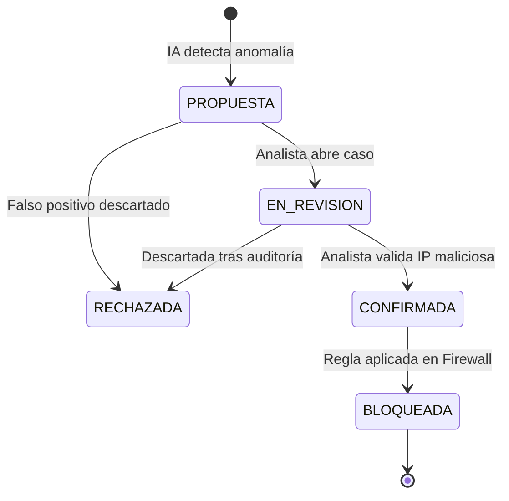

# 🧠 Global Business Logic & Domain Invariants Advisor

Esta Skill actúa como un **Auditor de Lógica de Dominio** para asegurar que el software no solo compile técnicamente, sino que respete de forma estricta las reglas del negocio real.

---

## 1. Invariantes de Dominio (Reglas que NUNCA pueden violarse)
Un invariante es una regla de verdad absoluta del negocio. El agente debe auditar y prevenir violaciones lógicas:

| Dominio | Invariante de Negocio | Violación a Prevenir | Mecanismo de Defensa |
| :--- | :--- | :--- | :--- |
| **Ciberseguridad (HoneyMetrics)** | Una IP en Lista Blanca nunca puede ser bloqueada automáticamente por un bot. | Falso positivo bloqueando al administrador. | Verificación prioritaria de Whitelist antes de ejecutar reglas de Blacklist. |
| **Inventario / ERP (TantauStock)** | El stock físico disponible nunca puede ser menor a cero. | Vender productos inexistentes por concurrencia. | Check constraint en base de datos (`CHECK (stock >= 0)`) + validación en Service Layer. |
| **Autenticación (Users)** | Un usuario bloqueado por intentos fallidos no puede resetear contraseña sin validar identidad secundaria. | Bypass del bloqueo mediante recuperación de clave. | Bloqueo global de todas las acciones del usuario mientras el estado sea `LOCKED`. |

---

## 2. Máquinas de Estado Finito (State Machine Pattern)
Toda entidad que cambie de estado a lo largo del tiempo (ej. `SolicitudDescarga`, `AmenazaIP`, `OrdenCompra`) debe tener una **tabla de transiciones válidas**:



### Regla Estricta de Código:
Prohibido permitir transiciones arbitrarias como pasar de `RECHAZADA` a `BLOQUEADA` directamente.
```python
class ThreatStatusTransitionValidator:
    VALID_TRANSITIONS = {
        "PROPUESTA": ["EN_REVISION", "RECHAZADA"],
        "EN_REVISION": ["CONFIRMADA", "RECHAZADA"],
        "CONFIRMADA": ["BLOQUEADA"],
        "BLOQUEADA": ["DESBLOQUEADA_MANUAL"],
        "RECHAZADA": [] # Estado terminal
    }

    @classmethod
    def validate(cls, current_status: str, new_status: str):
        if new_status not in cls.VALID_TRANSITIONS.get(current_status, []):
            raise InvalidStateTransitionException(
                f"Transición ilegal de negocio: {current_status} ➔ {new_status}"
            )
```

---

## 3. Pistas de Auditoría y Trazabilidad (Audit Trail)
- Toda acción que altere el estado de negocio debe registrar:
  1. `actor_id` (Quién lo hizo: Usuario, Sistema automático o IA).
  2. `action` (Qué cambió: `IP_BLOCKED`, `STOCK_ADJUSTED`, `PASSWORD_RESET`).
  3. `reason` (Por qué: Justificación del analista o regla disparada).
  4. `timestamp` (Cuándo ocurrió en UTC).
  5. `previous_state` y `new_state` (Snapshot antes y después del cambio).
