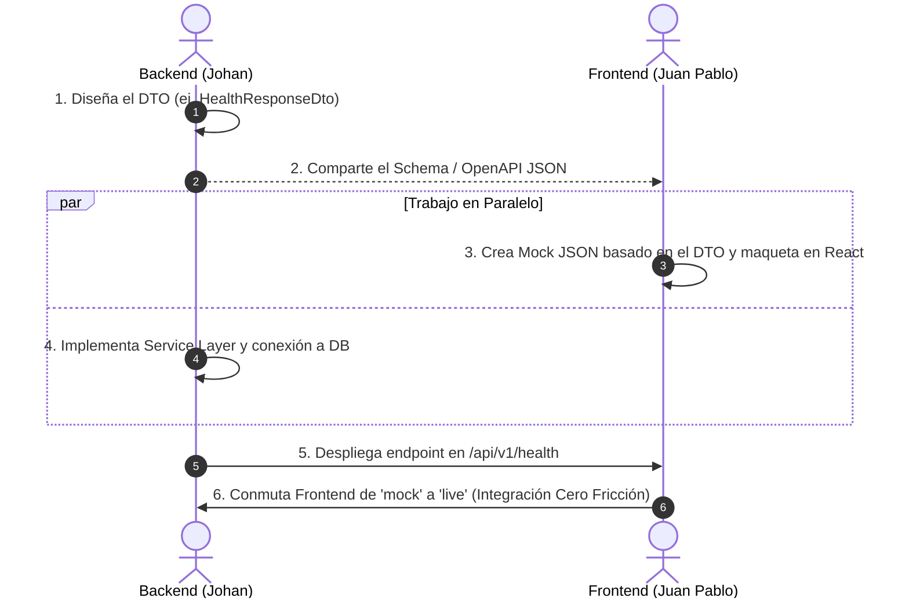

# 🤝 Coordinación de Contratos API y Estandarización JSON

> **Navegación:** [← Volver al Índice Central](../README.md) | [Siguiente: Guía Trello & Slack →](../guias/puesta-en-marcha-trello-slack.md)

---

## 📑 Tabla de Contenido
1. [El Problema del Desacoplamiento Frontend ↔ Backend](#1-el-problema-del-desacoplamiento-frontend--backend)
2. [Estandarización de Variables JSON (Nombres y Tipos)](#2-estandarización-de-variables-json-nombres-y-tipos)
3. [El Patrón DTO en Pydantic v2 como Contrato Inmutable](#3-el-patrón-dto-en-pydantic-v2-como-contrato-inmutable)
4. [Flujo de Trabajo Contract-First con Mocks para React](#4-flujo-de-trabajo-contract-first-con-mocks-para-react)
5. [Swagger y OpenAPI: La Única Fuente de la Verdad](#5-swagger-y-openapi-la-única-fuente-de-la-verdad)

---

## 1. El Problema del Desacoplamiento Frontend ↔ Backend

En proyectos donde dos ingenieros colaboran (Johan en Backend y Juan Pablo en Frontend), el error más común es la **desincronización de variables**:
- El backend envía `{ "full_name": "Juan" }` pero el frontend espera `{ "nombre_completo": "Juan" }` o `{ "fullName": "Juan" }`.
- Como consecuencia, los componentes de React muestran valores `undefined` o vacíos.

Para erradicar este problema en HoneyMetrics v2, se implementa una disciplina estricta de **Contract-First (Contrato Primero)**.

---

## 2. Estandarización de Variables JSON (Nombres y Tipos)

### Regla 1: Nomenclatura Snake_Case en la API
Todos los payloads JSON transmitidos por HTTP (tanto en peticiones `POST`/`PUT` como en respuestas de la API) utilizarán **estrictamente `snake_case`**:
- ✅ `access_token` (No `accessToken` ni `token`)
- ✅ `uptime_seconds` (No `uptimeSeconds` ni `uptime`)
- ✅ `is_active` (No `isActive` ni `estado`)
- ✅ `created_at` (No `createdAt` ni `fecha`)

### Regla 2: Marcas de Tiempo en Formato ISO-8601 UTC
Toda fecha y hora transmitida debe cumplir el estándar `YYYY-MM-DDTHH:MM:SSZ`. Ejemplo:
```json
{
  "timestamp": "2026-09-10T14:40:00Z"
}
```
En React se formatea fácilmente con `new Date(data.timestamp).toLocaleString()`.

---

## 3. El Patrón DTO en Pydantic v2 como Contrato Inmutable

Cada recurso expone dos tipos de DTOs en `app/schemas/`:
1. **Request DTO (`*RequestDto`):** Especifica los campos estrictamente necesarios para procesar la acción. Pydantic rechaza campos extras no autorizados y valida tipos.
2. **Response DTO (`*ResponseDto`):** Filtra información privada o interna de la base de datos (como contraseñas encriptadas, llaves de API o campos de auditoría interna).

```python
# app/schemas/auth.py
from pydantic import BaseModel, ConfigDict, EmailStr, Field

# Contrato de Entrada (Lo que el Frontend debe enviar en POST /api/v1/auth/login)
class LoginRequestDto(BaseModel):
    email: EmailStr = Field(..., description="Correo institucional o corporativo")
    password: str = Field(..., min_length=6, description="Contraseña en texto plano")

# Contrato de Salida (Lo que el Backend garantiza entregar)
class TokenResponseDto(BaseModel):
    access_token: str
    token_type: str = "bearer"
    must_change_password: bool = False

    model_config = ConfigDict(from_attributes=True)
```

---

## 4. Flujo de Trabajo Contract-First con Mocks para React



Gracias a este flujo:
- Juan Pablo no tiene que esperar a que Johan termine la base de datos para comenzar a programar la UI.
- Si la red de la universidad falla, el Frontend conmuta automáticamente al mock JSON garantizando una sustentación 100% fluida.

---

## 5. Swagger y OpenAPI: La Única Fuente de la Verdad

El servidor de FastAPI genera automáticamente el contrato interactivo:
- **URL Interactiva:** [http://localhost:8001/docs](http://localhost:8001/docs)
- **Especificación JSON cruda:** [http://localhost:8001/api/v1/openapi.json](http://localhost:8001/api/v1/openapi.json)

Cualquier cambio en los campos de una entidad debe reflejarse primero en el DTO de `app/schemas/`. El contrato Swagger se actualiza solo en vivo, sirviendo de documentación viva oficial.

---

> **Navegación:** [← Volver al Índice Central](../README.md) | [Siguiente: Guía Trello & Slack →](../guias/puesta-en-marcha-trello-slack.md)
